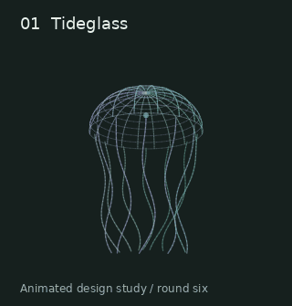
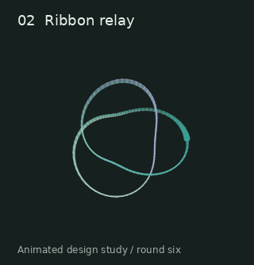
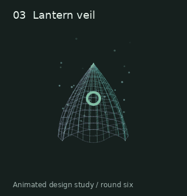
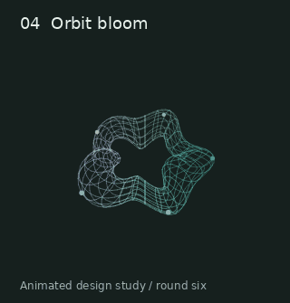

# Round six: depth studies

Four new 3D thinking-loader concepts for review. The animations below play directly in this GitHub page, including on a phone. They are recordings; the interactive version has theme/palette controls, pause, gentle motion, and rotation by dragging or arrow keys.

[Interactive HTML source](round-6-depth-studies.html) — download this single file and open it in a browser, or serve it from the cloned repo. GitHub displays HTML source rather than running it. There are no external assets, dependencies, or network requests in the standalone page.

## 01. Tideglass

Inspired by the jellyfish from round five and the flowing colors from round two. A ribbed translucent bell breathes while thin tentacles sway. My spin is a quieter wire sculpture rather than a dense dot cloud, with a small light inside the bell.

Review question: do you prefer the fine wire look or the original dots? The tentacles are less distinct at the 38 px chat preview size.

## 02. Ribbon relay

Inspired by the trefoil and Lissajous comet. Three offset strands wrap the same 3D knot while a bright bead and its short trail travel along it. This is the clearest abstract silhouette of these four at small size.

Review question: is this the right amount of movement, or would you prefer a still knot with only the bead moving?

## 03. Lantern veil

Inspired by the face-free wisp and veil from round four. A floating open shell has a rippling hem, a small ring of light inside, and drifting dust outside. My spin is a lantern-like form without eyes or a character face.

Review question: does the pointed silhouette feel like a lantern, a ghost, or too much like a cone? Dust is intentionally subtle and may disappear at chat size.

## 04. Orbit bloom

Inspired by the shape net and breathing torus. A woven ring opens into a five-petal outline and folds back, with five lights traveling around its outer surface. This uses a continuous change in the surface rather than switching between recognizable objects.

Review question: do you prefer this gradual transformation or the earlier mesh cycling through hearts, stars, and other shapes? This is the densest drawing of the four.

## Phone and desktop previews

The interactive page shows one column on phones and two on desktop, with 44 px minimum button heights, large 260 px views, and 38 px chat-size previews. Horizontal dragging rotates a shape; vertical touch scrolling remains available. Choose Tide, Ember, or Ink with either theme.

- [Phone, dark](round-6-previews/phone-dark.png)
- [Phone, light / Ember](round-6-previews/phone-light.png)
- [Desktop, dark](round-6-previews/desktop-dark.png)
- [Desktop, light](round-6-previews/desktop-light.png)

## Scope and validation

These are standalone planning mockups. The application, its styles, and its loading behavior are unchanged. Colors are prototype palettes; any adopted loader must use the app's theme tokens. None represents a percentage, ETA, or measured progress.

The interactive version projects 3D coordinates into a plain 2D canvas, sorts line segments by depth, and uses no libraries or WebGL. Offscreen canvases stop drawing; hidden tabs do not advance animation. Reduced-motion preference starts on a still frame; Play is an explicit opt-in. Gentle motion slows the animation. GIF recordings cannot follow the reduced-motion preference, so they are review assets only, not proposed UI assets.

Checked in system Chromium 154: widths 320, 390, and 430 px without horizontal overflow; dark/light themes; palette buttons; keyboard rotation; reduced-motion stillness and explicit Play; no browser errors. Captured desktop screenshots in both themes and phone screenshots. Real iOS/Android touch behavior and device performance have not been tested; these checks establish prototype behavior in browser emulation, not production readiness. The phone screenshots show dark at 390 px and light at 430 px.

The recorded animations show 12.6 seconds, then restart; that restart is a recording loop, not the interactive animation's timing. The pause label in screenshots says Play because the capture used a fixed frame. No speed or battery-life improvement is claimed. Review the shapes and their small-size legibility before choosing a design or approving app integration.
